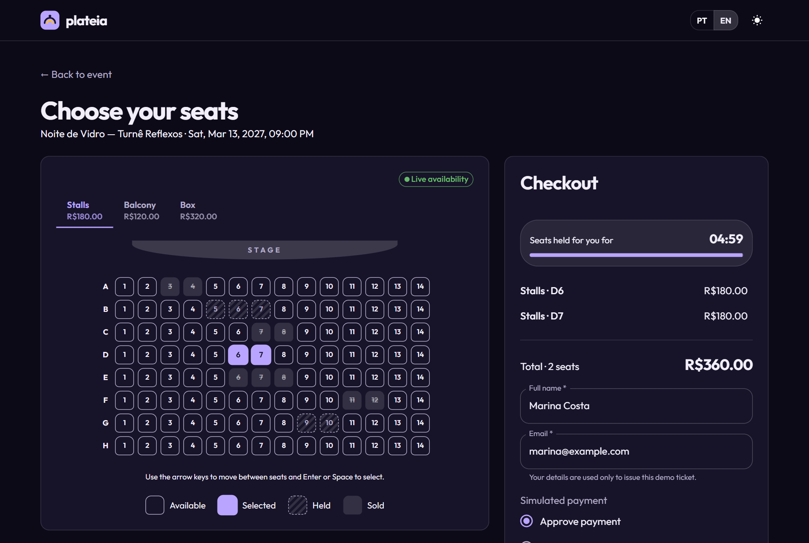
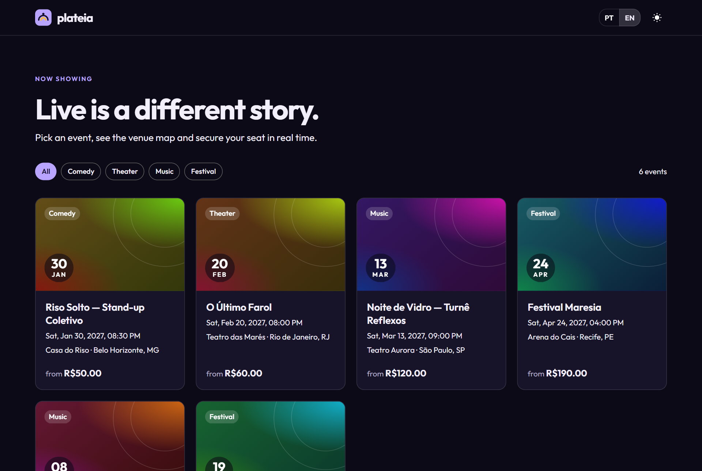
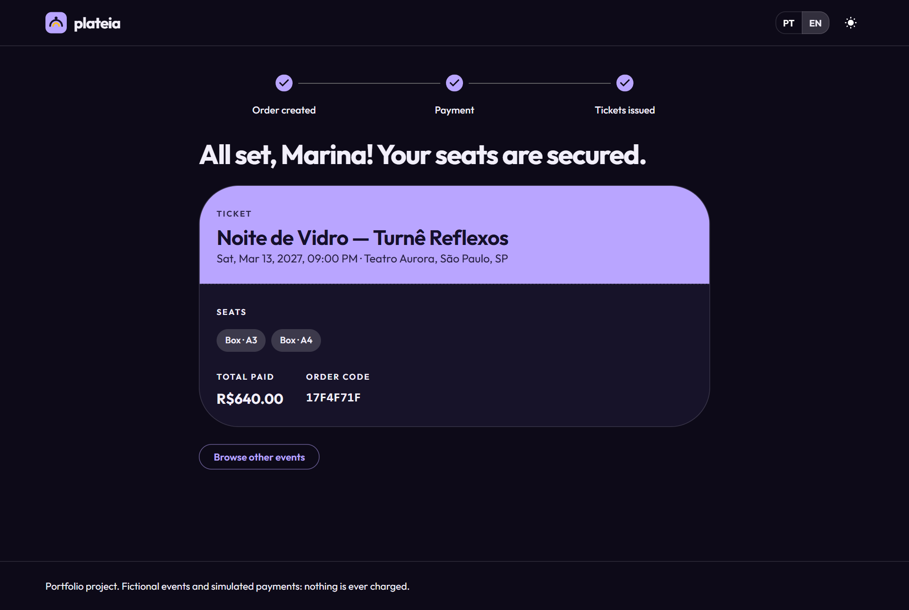
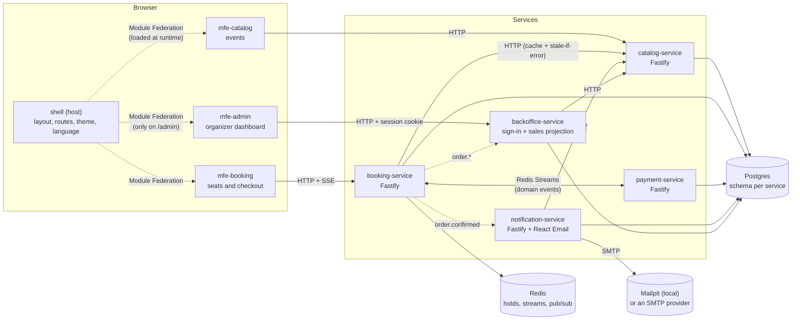
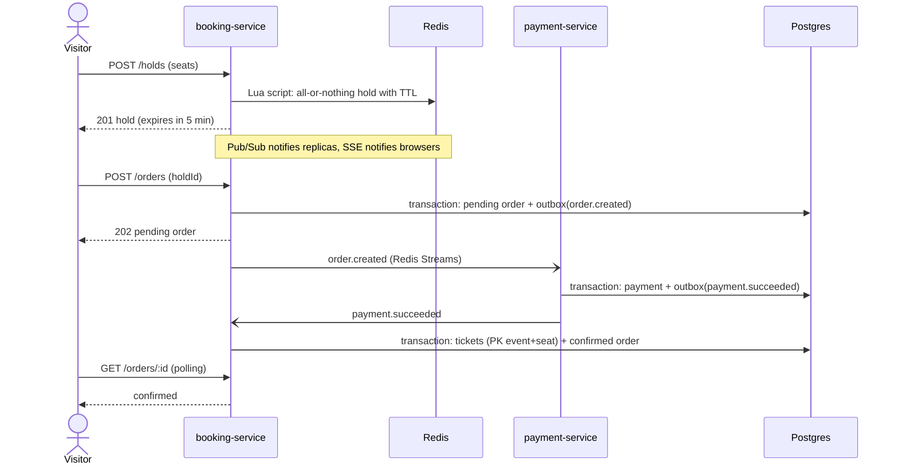
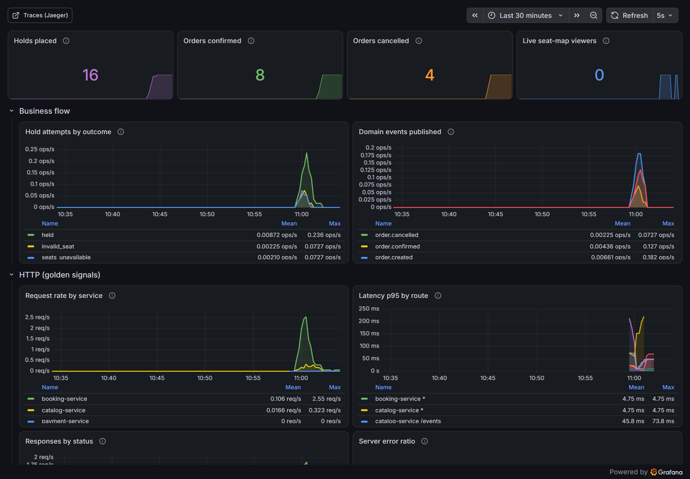
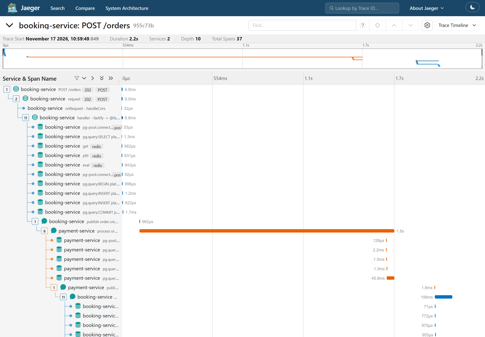
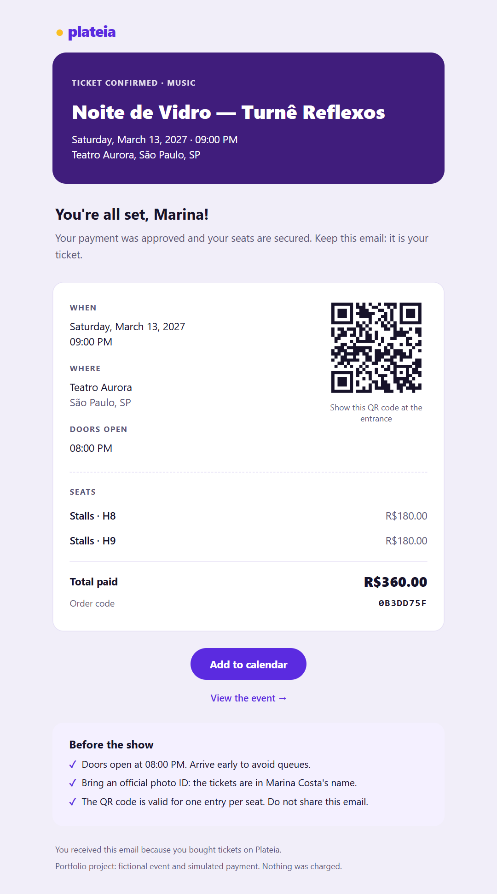
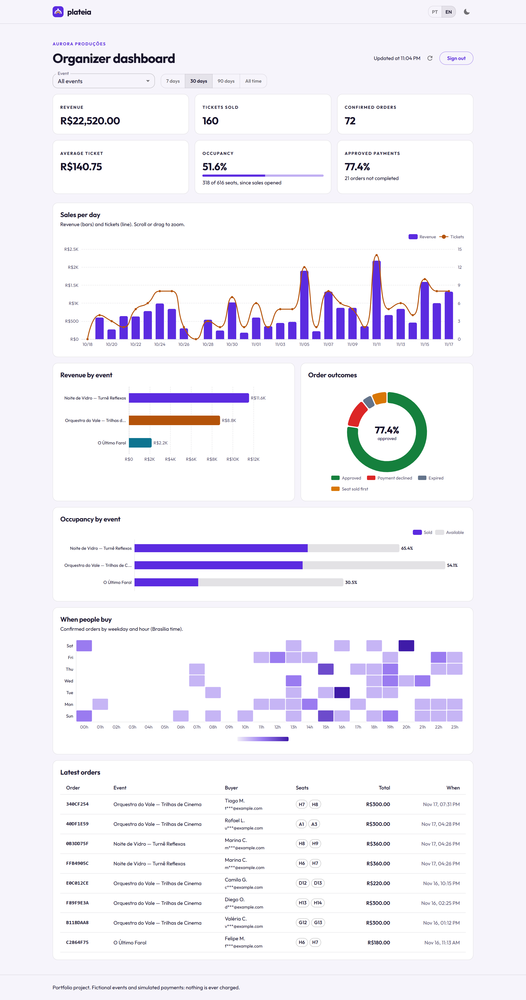

# Plateia

[](https://github.com/odaairlopes/plateia/actions/workflows/ci.yml) [](./LICENSE)

> Ticketing platform with real-time seat selection.
> Micro frontends with Module Federation, event-driven Fastify microservices, Postgres and Redis.

🇧🇷 [Leia em português](./README.md)



Portfolio project. The events are fictional and the payment is simulated: no card data exists anywhere in the system.

## The problem

Selling tickets looks like CRUD until two people click the same seat in the same second. This project exists to handle that scenario well:

- **Nobody buys the same seat twice**, even with several replicas of the service.
- **The seat stays held while the visitor pays**, and goes back on sale by itself if they give up.
- **Payment is asynchronous** and may fail, arrive late or arrive twice without leaving the order inconsistent.
- **Everyone sees an up-to-date map** without reloading the page.

## Screenshots

<table>
  <tr>
    <td width="50%"></td>
    <td width="50%"></td>
  </tr>
</table>

## Architecture



| Part | Responsibility |
|---|---|
| `apps/shell` | Host. Layout, routes, light/dark theme, language. Isolates each remote's failures with an error boundary. |
| `apps/mfe-catalog` | Remote. Event list and detail. |
| `apps/mfe-booking` | Remote. Real-time seat map, hold, checkout and order tracking. |
| `apps/mfe-admin` | Remote. Organizer dashboard: sign-in, KPIs and sales charts (ECharts). |
| `services/catalog` | Read model of events and sections. |
| `services/booking` | Temporary holds (Redis), orders and tickets (Postgres), checkout saga. |
| `services/payment` | Simulated payment provider, driven only by events. |
| `services/notification` | Emails the tickets once an order is confirmed. |
| `services/backoffice` | Organizer sign-in and sales reporting, from a projection of the events. |
| `packages/contracts` | Zod schemas for APIs and events. A single source of truth for back end and front end. |
| `packages/platform` | Service foundation: HTTP factory, event bus, outbox, migrations. |
| `packages/web-kit` | Front-end foundation: theme, providers, i18n, HTTP client. |

## The purchase flow



If the payment is declined, the order is cancelled and the seats go back on sale. If the hold expires during payment and someone else buys the seat, the order is cancelled and an `order.cancelled` event triggers the refund in the payment service (the saga's compensating action).

Once the order is confirmed, the notification service emails the tickets, with a QR code, in the language the visitor used on the site.

## Architecture decisions and trade-offs

**Two layers against double-selling.** The temporary hold lives in Redis: one key per seat with a TTL, acquired by a Lua script so several seats are held atomically. It is fast and cleans up after itself. The final guarantee, though, is the `(event_id, seat_id)` primary key of the tickets table in Postgres. Even if Redis loses data, the database refuses the second sale. *Trade-off:* two sources of state for the seat map, merged on read.

**Transactional outbox instead of publishing straight to the broker.** Writing to the database and publishing an event are two operations; one can fail without the other. The event is stored in the same transaction as the state change and a relay publishes it afterwards (`FOR UPDATE SKIP LOCKED`, safe with several replicas). *Trade-off:* at-least-once delivery, so every consumer must be idempotent. Here idempotency comes from unique constraints (`hold_id` on orders, `order_id` on payments) and from checking the state before acting.

**Choreographed saga.** Services react to events, with no central orchestrator. For three steps, it is the simplest design. *Trade-off:* the flow is spread out; with more participants an orchestrator would start to pay off.

**Redis Streams as the bus.** Consumer groups, explicit acknowledgement, retries with backoff and a dead-letter stream. Redis was already in the stack for the holds, which avoids operating Kafka or RabbitMQ as well. *Trade-off:* weaker retention and per-partition ordering guarantees than Kafka.

**SSE that only signals.** The server only says "something changed"; the browser refetches the seat map. A lost message or a reconnect can never leave the screen wrong. *Trade-off:* one extra request per change, in exchange for no duplicated state on the client.

**Guarded synchronous call from booking to catalog.** Booking needs prices and the venue layout. The call has a timeout, a short cache, and serves the last known value if the catalog is down. *Trade-off:* a price change takes up to 30 s to reach booking. The next step would be replicating the catalog through events.

**Micro frontends with a minimal contract.** Each remote exposes only prop-less pages; data flows through the URL and shared singletons (React, router, MUI, React Query, i18next). Each remote registers its own translations and runs by itself in standalone mode. *Trade-off:* the versions of the shared dependencies must move together.

**Prices computed on the server.** The client sends only seat identifiers; the total always comes from the catalog.

**No login, for now.** An anonymous session id tells "my hold" from someone else's. It is not authentication, and this README does not pretend it is. Orders from another session answer 404, without revealing that they exist.

## Stack

- **Front end:** React 19, TypeScript, Vite 8, Module Federation (`@module-federation/vite`), Material UI 9, React Query, React Router, React Hook Form, Zod, i18next, ECharts
- **Back end:** Node.js, Fastify 5, Zod (`fastify-type-provider-zod`), OpenAPI/Swagger, JWT in an httpOnly cookie, argon2id
- **Data:** PostgreSQL 17, Redis 8 (keys with TTL, Lua scripts, Streams, Pub/Sub)
- **Observability:** OpenTelemetry (SDK + Collector), Jaeger, Prometheus, Grafana
- **Tests:** Vitest, Playwright
- **Local infra:** Docker Compose, npm workspaces

## Running it

Requirements: Node.js 22+ and Docker.

```bash
npm install
npm run infra:up   # Postgres (5433) and Redis (6380)
npm run dev        # 5 services + 4 web apps
npm run seed:demo  # optional: sales history for the organizer dashboard
```

Open http://localhost:5173. Migrations and sample data are applied when the services start. No `.env` is needed; see `.env.example` to override values.

| Address | What |
|---|---|
| http://localhost:5173 | Application (shell) |
| http://localhost:5174 · 5175 | Micro frontends in standalone mode |
| http://localhost:3001/docs | Catalog OpenAPI |
| http://localhost:3002/docs | Booking OpenAPI |
| http://localhost:8025 | Mailpit: local inbox with every email sent |
| http://localhost:5173/admin | Organizer dashboard (demo accounts below) |
| http://localhost:3005/docs | Back-office OpenAPI |

To see the concurrency, open the same event in two windows (one of them private): a seat held in one shows up as blocked in the other in real time.

```bash
npm test           # domain and use case tests
npm run typecheck  # strict TypeScript across all workspaces
npm run smoke      # end-to-end purchase flow against the running services

# Browser tests (Playwright), with the services running (npm run dev:services):
npx playwright install chromium  # first time only
npm run build:web:prod           # the site exactly as Vercel publishes it
npm run e2e                      # starts the gateway and the site, then runs the tests
```

## Observability

```bash
npm run obs:up   # Collector, Jaeger, Prometheus and Grafana
```

| Address | What |
|---|---|
| http://localhost:3030 | Grafana, with the "Plateia — Overview" dashboard already provisioned |
| http://localhost:16686 | Jaeger: distributed traces |
| http://localhost:9090 | Prometheus |





*One purchase trace in Jaeger: 37 spans across two services, from the HTTP request to the issued tickets, through the queue.*

Services export everything over OTLP to the **OpenTelemetry Collector**, which forwards traces to Jaeger and exposes metrics to Prometheus. A service does not know where its telemetry goes; changing the destination is a Collector configuration change, with no redeploy. With the stack down, exports fail silently and nothing changes for the application.

**One trace per purchase, across services and the queue.** The trace context (W3C `traceparent`) is stored next to the event in the outbox and travels inside the Redis Streams message. So `POST /orders`, the publishing of `order.created`, its processing in the payment service, the `payment.succeeded` coming back and the tickets being issued all show up as a single trace, even though the outbox relay runs outside any request.

**Business metrics, not only infrastructure:** hold attempts by outcome (`held`, `seats_unavailable`…), domain events published and consumed, delivery lag and processing time per event, executions that went to retry or dead-letter, and open SSE connections. HTTP metrics (rate, latency, errors per route) come from auto-instrumentation.

**Correlated logs:** every log line carries `trace_id` and `span_id`.

Decisions: business metrics are applied as decorators at the composition root, so the application layer and its tests know nothing about telemetry. Queries from background loops (outbox relay, stream reads) produce no spans, so they do not drown the real traces. Host and process detectors are off, avoiding high-cardinality labels and machine details in the metrics.

## Confirmation email



When an order is confirmed, `notification-service` consumes the `order.confirmed` event and emails the tickets.

- **React template** with [React Email](https://react.email): table layout, inline styles, solid colors and system fonts, which is what email clients (Gmail, Outlook, Apple Mail) actually support. A plain-text version goes along.
- **QR code as an inline attachment** (`cid:`): Gmail strips data-URI images, and a hosted image would need a public server.
- **In the site's language:** the order stores the language the visitor bought in, and dates and times are shown in the venue's time zone, whatever the server's is.
- **No duplicate emails:** the bus delivers at least once, so each send is logged under `(order, kind)`. A redelivered event does not send again. The log does not store the email address.
- **No replaying the past:** a new consumer of an event with external side effects starts at the end of the stream (`startFrom: 'latest'`). Starting at the beginning would email every past customer.
- **Data carried in the event:** `order.confirmed` carries name, email and language, so notifications never call back into booking. In exchange, personal data travels on the bus, and the stream must be treated as sensitive storage.

### Where the emails go

In development no email leaves the machine: [Mailpit](https://mailpit.axllent.org) receives everything over SMTP and shows it at http://localhost:8025. To see the template with no SMTP or database:

```bash
npm run preview:email -w @plateia/notification-service
```

To deliver for real, point SMTP at a provider. [Brevo](https://www.brevo.com), for example, has a free plan of 300 emails a day. Copy `.env.example` to `.env` and fill in `SMTP_HOST`, `SMTP_PORT`, `SMTP_USER`, `SMTP_PASS` and `MAIL_FROM` (a sender verified with the provider). No code changes.

## Organizer dashboard



At http://localhost:5173/admin, each production company sees the sales of its own events: revenue, tickets, average ticket, occupancy, approved payment rate, sales per day, revenue and occupancy per event or per section, order outcomes, a heatmap of when people buy and the latest orders. The event and period filters live in the URL, so a filtered view can be bookmarked or shared.

- **A separate micro frontend (`mfe-admin`):** nothing public links to it, and its code (ECharts included) is only downloaded by whoever opens `/admin`. Ticket buyers never load the dashboard.
- **Security on the server, not in the UI:** argon2id password hashing, a session in an `httpOnly` + `SameSite=Strict` cookie (unreachable from JavaScript and never sent by other sites) and login rate limiting. An unknown email and a wrong password get the same answer in the same time. Every query is limited to the organizer's events; another company's event answers 404, as if it did not exist.
- **Reads separated from writes (CQRS):** `backoffice-service` keeps its own read model, fed by `order.created`, `order.confirmed` and `order.cancelled`. A new consumer reads the stream from the beginning, so the projection can be dropped and rebuilt at any time. It only stores the buyer's masked email.
- **Charts with [ECharts](https://echarts.apache.org):** only the chart types in use are registered (tree-shaking), rendered as SVG, with a text summary for screen readers, light and dark theme colors, and no animation for people who ask for reduced motion.

### Demo accounts and data

| Account | Company | Events |
|---|---|---|
| `ana@aurora.dev` | Aurora Produções | Noite de Vidro, Orquestra do Vale, O Último Farol |
| `bruno@marealta.dev` | Maré Alta Eventos | Festival Maresia, Circuito Baixo Centro, Riso Solto |

The password for both is `plateia-demo-2026`. These are development accounts created by the service's migration.

So the dashboard does not start empty, there is a history of about 75 days of sales:

```bash
npm run seed:demo
```

The seed writes the orders straight into the booking and back-office databases, so the seats show as sold on the map and in the dashboard. It does not go through the event bus: rebuilding the projection from the stream would not bring these orders back. That is why they are marked `source = 'seed'`.

## Production

The project runs on free plans: static front end on **Vercel**, backend in a Docker container on **Render**, Postgres on **Neon**, Redis on **Redis Cloud** and email through **Brevo**. Step by step (in Portuguese) in [docs/deploy.md](./docs/deploy.md).

- **One site, one origin:** Vercel publishes the shell and the three micro frontends as a single project (`/` and `/mf/*`) and proxies `/api/*` to the backend. To the browser it is all the same domain: the dashboard cookie works with `SameSite=Strict` and there is no CORS.
- **One container, five processes:** the free plan allows one web service, so the image runs the five services as separate processes (each with its own schema, pool and lifecycle), behind a `node:http` gateway that streams responses through (SSE included). The image uses about 340 MB of the 512 MB available.
- **Production build:** each service becomes a JavaScript bundle (esbuild), with dependencies resolved from `node_modules` at runtime. The final image holds production dependencies only and does not run as root.
- **Tuned to free-tier limits:** few database connections per service, a capped event stream, per-recipient and daily email limits, and the real client IP behind the proxies for rate limiting.
- **Trade-off:** the backend sleeps after 15 minutes without traffic, and the first visit after that takes about a minute.

## Tests

The business rules depend on ports (interfaces), not on Postgres or Redis, so the use cases are tested with in-memory implementations: two visitors racing for the same seat, hold expiry, checkout idempotency, a duplicated payment event, compensation when the seat is sold to someone else, and a payment that arrives after the order expired.

The smoke test (`scripts/smoke.ts`) covers what unit tests cannot reach: real Postgres and Redis, the Lua hold scripts, the outbox relay and the saga across two services. It buys seats and checks that a second visitor cannot hold them, that a repeated checkout does not duplicate the order, that a declined payment releases the seat, that an order is not visible to another session, that the ticket email arrives with the order code and the QR code, and that the sale shows up on the dashboard of the company that owns the event, and only on theirs.

The browser tests (`e2e/`, Playwright) run against the production build of the site, served as on Vercel (`/api` forwarded to the gateway), with the four micro frontends loaded through Module Federation:

- **Race between two browsers:** two visitors click the same seat and hold it at the same time; exactly one gets it. Live updates are cut on purpose in this test, so both requests really reach the server and the race happens there.
- **Live map:** one visitor's hold shows up for the other without a reload, and disappears when released.
- **Full purchase:** from the event list to the issued ticket, through the asynchronous payment, with the sale reaching the organizer's dashboard. A declined payment puts the seat back on sale.
- **Dashboard:** a wrong password does not get in, an organizer only sees their own events, the cookie is `httpOnly` and `SameSite=Strict`, and signing out ends the session on the server.
- **Accessibility:** the map is a single Tab stop, the arrow keys move between seats and the keyboard selects.

Seats are picked from those free at the moment, so the suite runs again and again against the same database.

### Continuous integration

GitHub Actions runs on every push and pull request:

1. **Quality**, on Node 22 (lowest supported) and 24 (LTS): strict typecheck, unit tests and the site build exactly as Vercel publishes it.
2. **Smoke on the production image**, after quality: builds the same Docker image Render uses, runs it with 512 MB of memory against real Postgres, Redis and Mailpit, and runs `npm run smoke` through the gateway. Then the Playwright tests run against that same image; if they fail, the report with traces and screenshots is kept as an artifact. A broken Dockerfile fails in the PR, not in production.

The workflow has read-only permissions, cancels superseded runs on the same branch and pins actions to commit SHAs (a tag can be moved; a SHA cannot). Dependabot updates dependencies and actions weekly, grouping packages that must move together (OpenTelemetry, and the singletons shared across micro frontends).

## Accessibility

- Keyboard-navigable seat map (arrows, Home/End) with a roving tabindex: the map is a single Tab stop.
- Seat state never relies on color alone: each state has its own border, pattern and text alternative.
- Focus moves to the content on every navigation, a "skip to content" link, `aria-live` regions for notices.
- AA contrast in light and dark themes; honors `prefers-reduced-motion`.

## Next steps

- [x] E2E tests with Playwright, including the race between two browsers
- [ ] Integration tests for the adapters (Postgres, Redis) with Testcontainers
- [ ] Per-pull-request staging (Vercel preview with its own backend)
- [ ] Authentication and a "my tickets" area
- [ ] Replicate the catalog into booking through events, removing the synchronous call
- [ ] Traces starting in the browser and Prometheus alerts
- [ ] Virtual waiting room for high-demand sale openings
- [ ] Email address confirmation before sending (the per-recipient and daily send limits already exist), so checkout cannot be used to send spam

## License

[MIT](./LICENSE).
