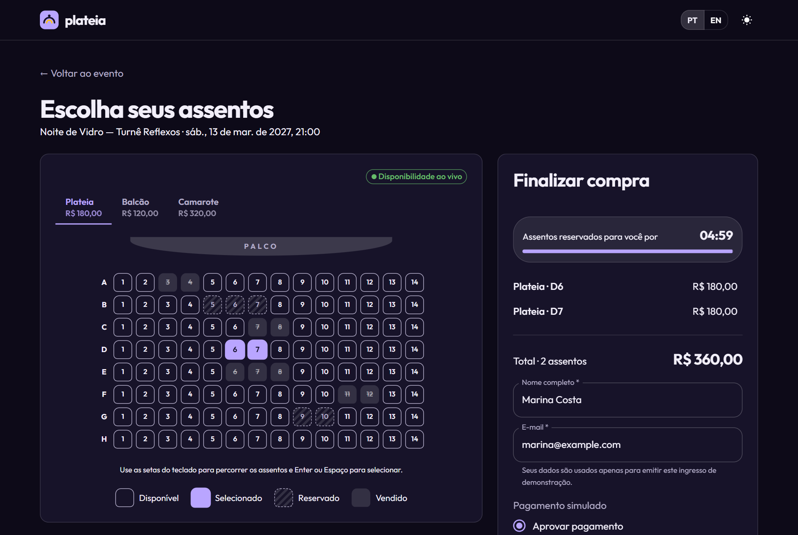
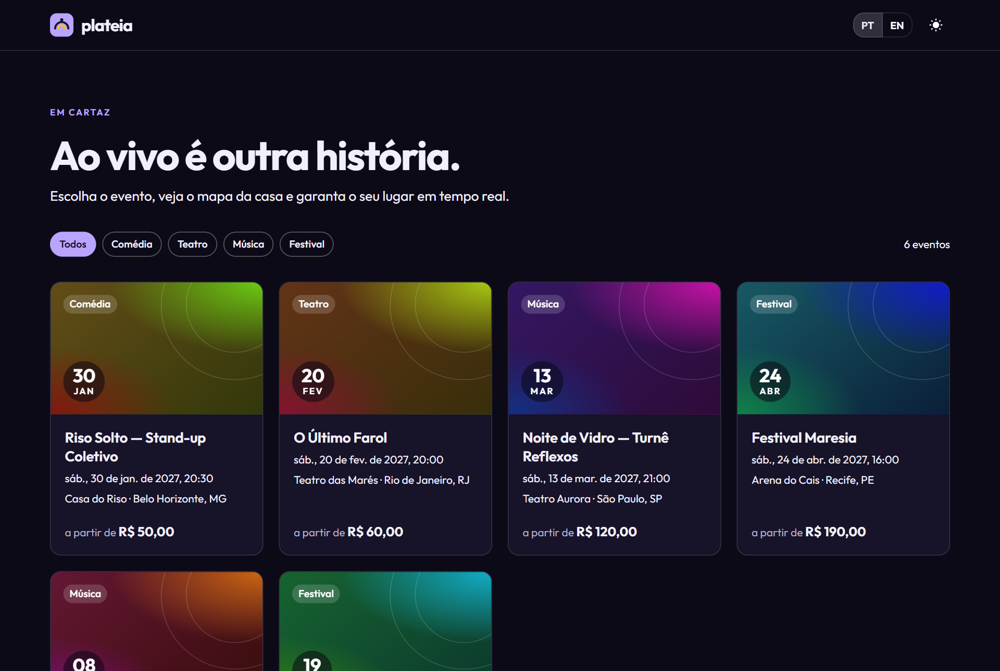
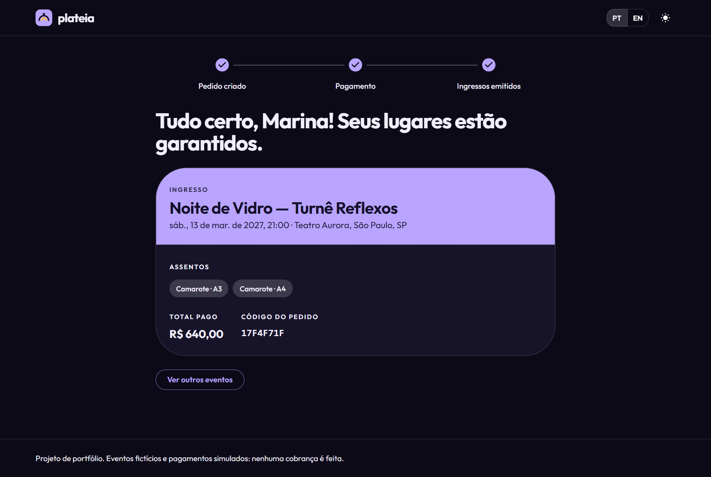
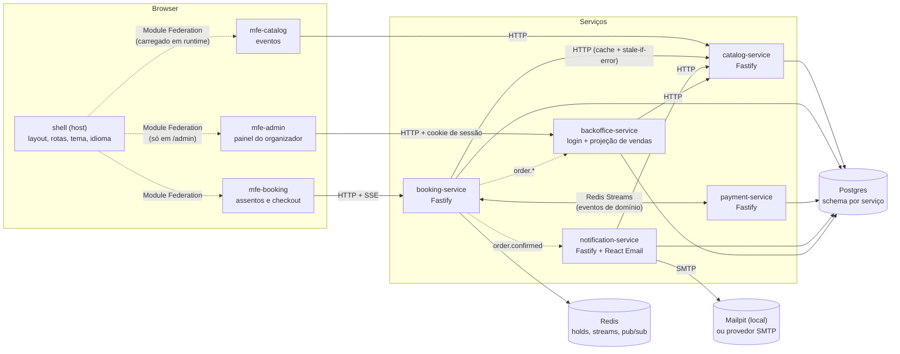
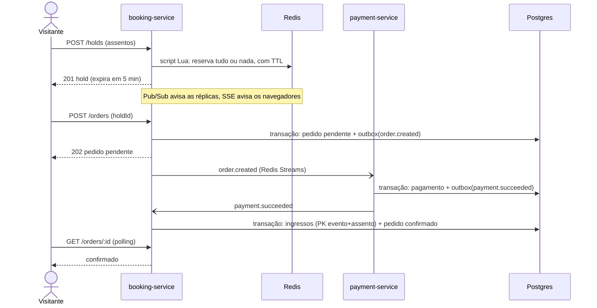
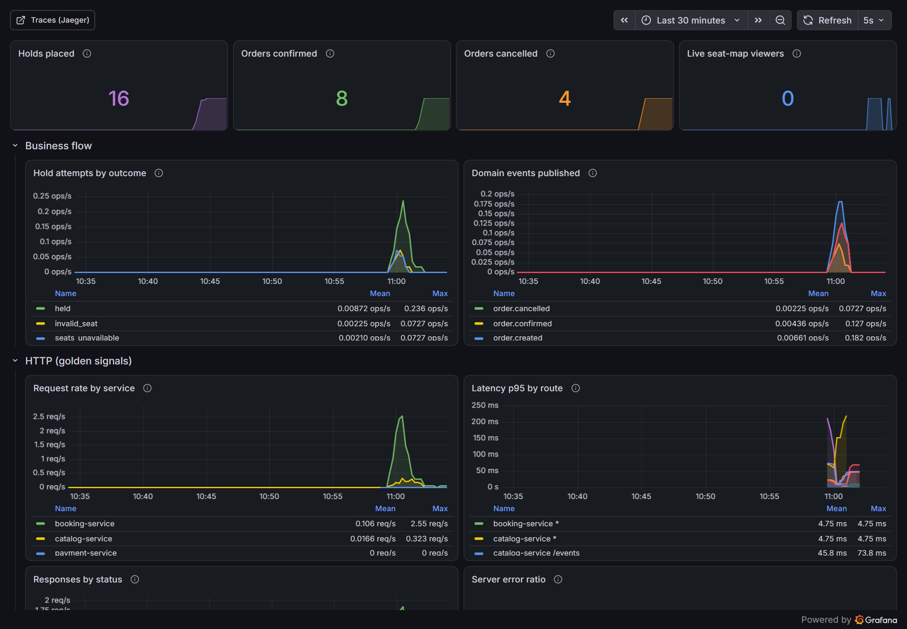
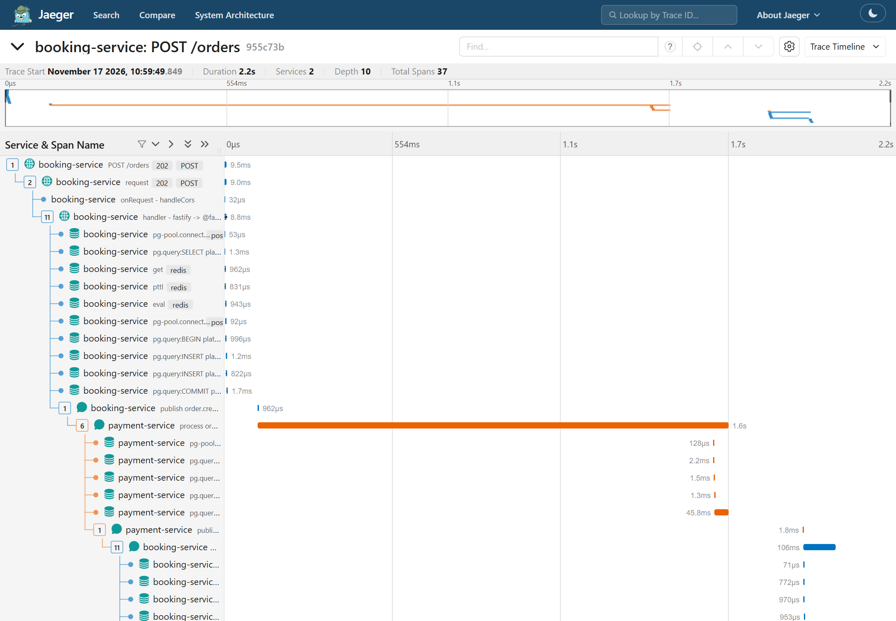
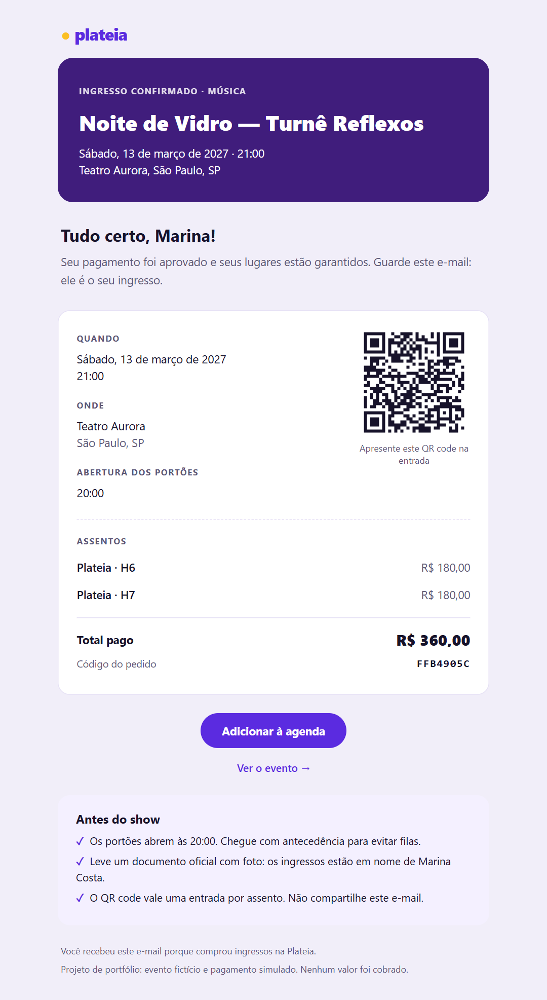
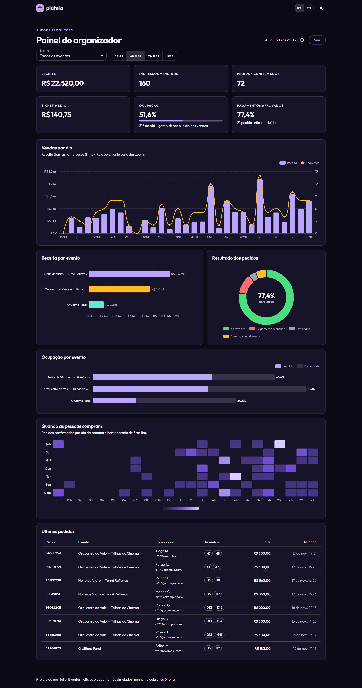

# Plateia

[](https://github.com/odaairlopes/plateia/actions/workflows/ci.yml) [](./LICENSE)

> Plataforma de venda de ingressos com escolha de assentos em tempo real.
> Micro frontends com Module Federation, microsserviços Fastify orientados a eventos, Postgres e Redis.

🇺🇸 [Read in English](./README.en.md)



Projeto de portfólio. Os eventos são fictícios e o pagamento é simulado: nenhum dado de cartão existe em parte alguma do sistema.

## O problema

Vender ingressos parece um CRUD até duas pessoas clicarem no mesmo assento no mesmo segundo. O projeto existe para resolver bem esse cenário:

- **Ninguém compra o mesmo assento duas vezes**, mesmo com várias réplicas do serviço.
- **O assento fica reservado enquanto a pessoa paga**, e volta sozinho para a venda se ela desistir.
- **O pagamento é assíncrono** e pode falhar, atrasar ou chegar duplicado sem deixar o pedido em estado inconsistente.
- **Todo mundo vê o mapa atualizado** sem recarregar a página.

## Telas

<table>
  <tr>
    <td width="50%"></td>
    <td width="50%"></td>
  </tr>
</table>

## Arquitetura



| Parte | Responsabilidade |
|---|---|
| `apps/shell` | Host. Layout, rotas, tema claro/escuro, idioma. Isola falhas de cada remote com error boundary. |
| `apps/mfe-catalog` | Remote. Lista e detalhe de eventos. |
| `apps/mfe-booking` | Remote. Mapa de assentos em tempo real, reserva, checkout e acompanhamento do pedido. |
| `apps/mfe-admin` | Remote. Painel do organizador: login, indicadores e gráficos de vendas (ECharts). |
| `services/catalog` | Modelo de leitura de eventos e setores. |
| `services/booking` | Reservas temporárias (Redis), pedidos e ingressos (Postgres), saga de checkout. |
| `services/payment` | Provedor de pagamento simulado, guiado apenas por eventos. |
| `services/notification` | Envia os ingressos por e-mail quando o pedido é confirmado. |
| `services/backoffice` | Login dos organizadores e relatórios de vendas, a partir de uma projeção dos eventos. |
| `packages/contracts` | Schemas Zod das APIs e dos eventos. Uma única fonte de verdade para back e front. |
| `packages/platform` | Base dos serviços: fábrica HTTP, barramento de eventos, outbox, migrações. |
| `packages/web-kit` | Base do front: tema, providers, i18n, cliente HTTP. |

## O fluxo de compra



Se o pagamento for recusado, o pedido é cancelado e os assentos voltam à venda. Se a reserva expirar durante o pagamento e outra pessoa comprar o assento, o pedido é cancelado e um `order.cancelled` dispara o estorno no serviço de pagamento (ação compensatória da saga).

Com o pedido confirmado, o serviço de notificação envia os ingressos por e-mail, com QR code, no idioma em que a pessoa usou o site.

## Decisões de arquitetura e trade-offs

**Duas camadas contra a venda duplicada.** A reserva temporária vive no Redis: uma chave por assento com TTL, adquirida por um script Lua para que vários assentos sejam reservados de forma atômica. É rápida e se limpa sozinha. A garantia final, porém, é a chave primária `(event_id, seat_id)` da tabela de ingressos no Postgres. Mesmo que o Redis perca dados, o banco recusa a segunda venda. *Trade-off:* duas fontes de estado para o mapa de assentos, unidas na leitura.

**Outbox transacional em vez de publicar direto no broker.** Gravar no banco e publicar um evento são duas operações; uma pode falhar sem a outra. O evento é gravado na mesma transação da mudança de estado e um relay o publica depois (`FOR UPDATE SKIP LOCKED`, seguro com várias réplicas). *Trade-off:* entrega pelo menos uma vez, então todo consumidor precisa ser idempotente. Aqui a idempotência vem de restrições únicas (`hold_id` nos pedidos, `order_id` nos pagamentos) e de checar o estado antes de agir.

**Saga coreografada.** Os serviços reagem a eventos, sem orquestrador central. Para três passos, é o desenho mais simples. *Trade-off:* o fluxo fica espalhado; com mais participantes, um orquestrador passaria a compensar.

**Redis Streams como barramento.** Grupos de consumidores, confirmação explícita, retentativas com backoff e uma stream de dead-letter. Já estava na stack por causa das reservas, então evita operar um Kafka ou RabbitMQ a mais. *Trade-off:* menos garantias de retenção e ordenação por partição que o Kafka.

**SSE que só sinaliza.** O servidor envia apenas "algo mudou"; o navegador refaz a consulta do mapa. Uma mensagem perdida ou uma reconexão nunca deixa a tela errada. *Trade-off:* uma requisição a mais por mudança, em troca de não manter estado duplicado no cliente.

**Chamada síncrona protegida entre booking e catalog.** O booking precisa de preços e do layout da casa. A chamada tem timeout, cache curto e serve o último valor conhecido se o catálogo cair. *Trade-off:* uma mudança de preço leva até 30 s para chegar ao booking. O próximo passo seria replicar o catálogo por eventos.

**Micro frontends com contrato mínimo.** Cada remote expõe apenas páginas sem props; os dados passam pela URL e por singletons compartilhados (React, router, MUI, React Query, i18next). Cada remote registra as próprias traduções e roda sozinho em modo standalone. *Trade-off:* as versões das dependências compartilhadas precisam andar juntas.

**Preço calculado no servidor.** O cliente envia só os identificadores dos assentos; o total sempre vem do catálogo.

**Sem login, por enquanto.** Um identificador anônimo de sessão diferencia "minha reserva" da de outra pessoa. Não é autenticação, e o README não finge que é. Pedidos de outra sessão respondem 404, sem revelar que existem.

## Stack

- **Front:** React 19, TypeScript, Vite 8, Module Federation (`@module-federation/vite`), Material UI 9, React Query, React Router, React Hook Form, Zod, i18next, ECharts
- **Back:** Node.js, Fastify 5, Zod (`fastify-type-provider-zod`), OpenAPI/Swagger, JWT em cookie httpOnly, argon2id
- **Dados:** PostgreSQL 17, Redis 8 (chaves com TTL, scripts Lua, Streams, Pub/Sub)
- **Observabilidade:** OpenTelemetry (SDK + Collector), Jaeger, Prometheus, Grafana
- **Testes:** Vitest
- **Infra local:** Docker Compose, npm workspaces

## Como rodar

Requisitos: Node.js 22+ e Docker.

```bash
npm install
npm run infra:up   # Postgres (5433) e Redis (6380)
npm run dev        # 5 serviços + 4 apps web
npm run seed:demo  # opcional: histórico de vendas para o painel do organizador
```

Abra http://localhost:5173. As migrações e os dados de exemplo são aplicados quando os serviços sobem. Nenhum `.env` é necessário; veja `.env.example` para sobrescrever valores.

| Endereço | O quê |
|---|---|
| http://localhost:5173 | Aplicação (shell) |
| http://localhost:5174 · 5175 | Micro frontends em modo standalone |
| http://localhost:3001/docs | OpenAPI do catálogo |
| http://localhost:3002/docs | OpenAPI de reservas |
| http://localhost:8025 | Mailpit: caixa de entrada local com todos os e-mails enviados |
| http://localhost:5173/admin | Painel do organizador (contas de demonstração abaixo) |
| http://localhost:3005/docs | OpenAPI do backoffice |

Para ver a concorrência, abra o mesmo evento em duas janelas (uma delas anônima): o assento reservado em uma aparece bloqueado na outra em tempo real.

```bash
npm test           # testes de domínio e casos de uso
npm run typecheck  # TypeScript estrito em todos os workspaces
npm run smoke      # fluxo de compra de ponta a ponta contra os serviços rodando
```

## Observabilidade

```bash
npm run obs:up   # Collector, Jaeger, Prometheus e Grafana
```

| Endereço | O quê |
|---|---|
| http://localhost:3030 | Grafana, com o dashboard "Plateia — Overview" já provisionado |
| http://localhost:16686 | Jaeger: traces distribuídos |
| http://localhost:9090 | Prometheus |





*Um trace de compra no Jaeger: 37 spans em dois serviços, da requisição HTTP à emissão dos ingressos, passando pela fila.*

Os serviços exportam tudo por OTLP para o **OpenTelemetry Collector**, que encaminha traces ao Jaeger e expõe métricas ao Prometheus. O serviço não sabe para onde a telemetria vai; trocar o destino é mudar a configuração do Collector, sem novo deploy. Sem a pilha no ar, a exportação falha em silêncio e nada muda para a aplicação.

**Um trace por compra, atravessando serviços e fila.** O contexto de trace (W3C `traceparent`) é gravado junto com o evento no outbox e viaja dentro da mensagem no Redis Streams. Assim, o `POST /orders`, a publicação do `order.created`, o processamento no serviço de pagamento, a volta do `payment.succeeded` e a emissão dos ingressos aparecem como um único trace, mesmo com o relay do outbox rodando fora de qualquer requisição.

**Métricas de negócio, não só de infraestrutura:** tentativas de reserva por resultado (`held`, `seats_unavailable`…), eventos de domínio publicados e consumidos, atraso de entrega e tempo de processamento por evento, execuções que foram para retentativa ou dead-letter, e conexões SSE abertas. As métricas HTTP (taxa, latência, erros por rota) vêm da instrumentação automática.

**Logs correlacionados:** cada linha de log carrega `trace_id` e `span_id`.

Decisões: as métricas de negócio são aplicadas como decoradores na raiz de composição, então a camada de aplicação e seus testes não conhecem telemetria. Consultas de laços de fundo (relay do outbox, leitura da stream) não geram spans, para não afogar os traces reais. Detectores de host e processo ficam desligados, evitando rótulos de alta cardinalidade e dados da máquina nas métricas.

## E-mail de confirmação



Quando o pedido é confirmado, o `notification-service` consome o evento `order.confirmed` e envia os ingressos por e-mail.

- **Template em React** com [React Email](https://react.email): layout em tabelas, estilos inline, cores sólidas e fontes do sistema, que é o que os clientes de e-mail (Gmail, Outlook, Apple Mail) realmente suportam. Vai junto uma versão em texto puro.
- **QR code como anexo inline** (`cid:`): o Gmail remove imagens em data URI, e uma imagem hospedada exigiria um servidor público.
- **No idioma do site:** o pedido guarda o idioma em que a pessoa comprou, e datas e horários saem no fuso do local do show, seja qual for o fuso do servidor.
- **Sem e-mail duplicado:** o barramento entrega pelo menos uma vez, então cada envio é registrado com a chave `(pedido, tipo)`. Um evento reentregue não envia de novo. O registro não guarda o endereço de e-mail.
- **Sem reenviar o passado:** um consumidor novo de um evento com efeito externo começa do fim da stream (`startFrom: 'latest'`). Começar do início mandaria e-mail para todos os clientes antigos.
- **Dados levados no evento:** o `order.confirmed` carrega nome, e-mail e idioma, então a notificação não precisa chamar o serviço de reservas. Em troca, dado pessoal passa pelo barramento, e a stream precisa ser tratada como armazenamento sensível.

### Onde os e-mails vão parar

Em desenvolvimento, nenhum e-mail sai da máquina: o [Mailpit](https://mailpit.axllent.org) recebe tudo por SMTP e mostra em http://localhost:8025. Para ver o template sem SMTP nem banco:

```bash
npm run preview:email -w @plateia/notification-service
```

Para entregar de verdade, basta apontar o SMTP para um provedor. O [Brevo](https://www.brevo.com), por exemplo, tem plano gratuito de 300 e-mails por dia. Copie `.env.example` para `.env` e preencha `SMTP_HOST`, `SMTP_PORT`, `SMTP_USER`, `SMTP_PASS` e `MAIL_FROM` (um remetente verificado no provedor). O código não muda.

## Painel do organizador



Em http://localhost:5173/admin, cada produtora vê as vendas dos próprios eventos: receita, ingressos, ticket médio, ocupação, taxa de pagamentos aprovados, vendas por dia, receita e ocupação por evento ou por setor, resultado dos pedidos, um mapa de calor de quando as pessoas compram e os últimos pedidos. Os filtros de evento e período ficam na URL, então uma visão filtrada pode ser salva ou compartilhada.

- **Microfront separado (`mfe-admin`):** não há link para ele na parte pública, e o código (com o ECharts) só é baixado por quem abre `/admin`. Quem compra ingresso nunca carrega o painel.
- **Segurança no servidor, não na tela:** login com senha em argon2id, sessão em cookie `httpOnly` + `SameSite=Strict` (inacessível a JavaScript e não enviado por outros sites) e limite de tentativas. E-mail inexistente e senha errada respondem igual e no mesmo tempo. Cada consulta é limitada aos eventos do organizador; o evento de outra produtora responde 404, como se não existisse.
- **Leitura separada da escrita (CQRS):** o `backoffice-service` mantém o próprio modelo de leitura, alimentado por `order.created`, `order.confirmed` e `order.cancelled`. Um consumidor novo lê a stream desde o início, então a projeção pode ser apagada e reconstruída a qualquer momento. Ela guarda só o e-mail mascarado do comprador.
- **Gráficos com [ECharts](https://echarts.apache.org):** só os tipos usados são registrados (tree-shaking), renderizados em SVG, com resumo em texto para leitores de tela, cores do tema claro ou escuro e animação desligada para quem pede menos movimento.

### Contas e dados de demonstração

| Conta | Produtora | Eventos |
|---|---|---|
| `ana@aurora.dev` | Aurora Produções | Noite de Vidro, Orquestra do Vale, O Último Farol |
| `bruno@marealta.dev` | Maré Alta Eventos | Festival Maresia, Circuito Baixo Centro, Riso Solto |

A senha das duas é `plateia-demo-2026`. São contas de desenvolvimento, criadas pela migração do serviço.

Para o painel não começar vazio, há um histórico de cerca de 75 dias de vendas:

```bash
npm run seed:demo
```

O seed grava os pedidos direto nos bancos de reservas e do backoffice, então os assentos aparecem vendidos no mapa e no painel. Ele não passa pelo barramento de eventos: reconstruir a projeção a partir da stream não traria esses pedidos de volta. Por isso eles são marcados como `source = 'seed'`.

## Produção

O projeto roda em planos gratuitos: front estático na **Vercel**, backend num contêiner Docker no **Render**, Postgres no **Neon**, Redis no **Redis Cloud** e e-mails pelo **Brevo**. O passo a passo está em [docs/deploy.md](./docs/deploy.md).

- **Um site, uma origem:** a Vercel publica o shell e os três microfronts num projeto só (`/` e `/mf/*`) e repassa `/api/*` ao backend. Para o navegador, tudo é o mesmo domínio: o cookie do painel funciona com `SameSite=Strict` e não há CORS.
- **Um contêiner, cinco processos:** o plano gratuito permite um serviço web, então a imagem roda os cinco serviços como processos separados (cada um com o próprio schema, pool e ciclo de vida), atrás de um gateway em `node:http` que repassa respostas em streaming (SSE incluído). A imagem usa cerca de 340 MB dos 512 MB disponíveis.
- **Build de produção:** cada serviço vira um bundle JavaScript (esbuild), com as dependências resolvidas de `node_modules` em tempo de execução. A imagem final tem só as dependências de produção e não roda como root.
- **Ajustado aos limites gratuitos:** poucas conexões por serviço com o banco, fila de eventos com tamanho máximo, limite de e-mails por destinatário e por dia, e IP real do cliente atrás dos proxies para o rate limit.
- **Trade-off:** o backend dorme após 15 minutos sem acesso, e a primeira visita depois disso leva cerca de 1 minuto.

## Testes

As regras de negócio dependem de portas (interfaces), não de Postgres ou Redis, então os casos de uso são testados com implementações em memória: disputa pelo mesmo assento, expiração da reserva, idempotência do checkout, evento de pagamento duplicado, compensação quando o assento é vendido para outra pessoa e pagamento que chega depois do pedido expirar.

O teste de fumaça (`scripts/smoke.ts`) cobre o que os testes unitários não alcançam: Postgres e Redis reais, os scripts Lua das reservas, o relay do outbox e a saga atravessando dois serviços. Ele compra assentos, confirma que um segundo visitante não consegue reservá-los, que o checkout repetido não duplica o pedido, que o pagamento recusado libera o assento, que um pedido não aparece para outra sessão, que o e-mail com os ingressos chega com o código do pedido e o QR code, e que a venda aparece no painel da produtora dona do evento, e só no dela.

### Integração contínua

O GitHub Actions roda em todo push e pull request:

1. **Qualidade**, em Node 22 (mínimo suportado) e 24 (LTS): typecheck estrito, testes unitários e o build do site exatamente como a Vercel publica.
2. **Fumaça na imagem de produção**, depois da qualidade: constrói a mesma imagem Docker que o Render usa, sobe com 512 MB de memória contra Postgres, Redis e Mailpit reais e roda `npm run smoke` pelo gateway. Um Dockerfile quebrado falha no PR, não em produção.

O workflow tem permissão só de leitura, cancela execuções obsoletas do mesmo branch e fixa as actions por SHA de commit (uma tag pode ser movida; um SHA, não). O Dependabot atualiza dependências e actions toda semana, agrupando os pacotes que precisam andar juntos (OpenTelemetry e os singletons compartilhados entre os micro frontends).

## Acessibilidade

- Mapa de assentos navegável por teclado (setas, Home/End) com *roving tabindex*: o mapa é uma única parada de Tab.
- O estado do assento nunca depende só de cor: há borda, padrão e texto alternativo para cada estado.
- Foco movido para o conteúdo a cada navegação, link "pular para o conteúdo", regiões `aria-live` para avisos.
- Contraste AA nos temas claro e escuro; respeita `prefers-reduced-motion`.

## Próximos passos

- [ ] Testes de integração com Testcontainers e E2E com Playwright (incluindo corrida entre dois navegadores)
- [ ] Ambiente de homologação por pull request (preview na Vercel com backend próprio)
- [ ] Autenticação e área "meus ingressos"
- [ ] Replicar o catálogo no booking por eventos, removendo a chamada síncrona
- [ ] Traces a partir do navegador e alertas no Prometheus
- [ ] Fila de espera virtual para aberturas de venda com alta demanda
- [ ] Antes de usar um provedor de e-mail real em produção: limite de envios por destinatário e confirmação do endereço, para o checkout não virar uma forma de mandar spam

## Licença

[MIT](./LICENSE).
