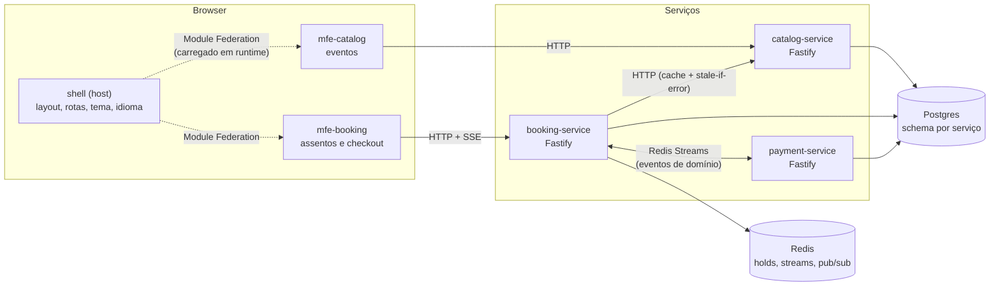
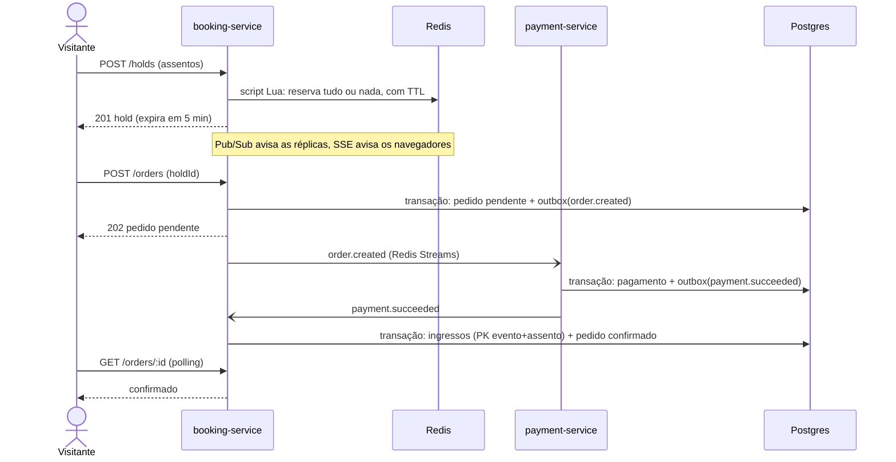

# Plateia

> Plataforma de venda de ingressos com escolha de assentos em tempo real.
> Micro frontends com Module Federation, microsserviços Fastify orientados a eventos, Postgres e Redis.

🇺🇸 [Read in English](./README.en.md)

Projeto de portfólio. Os eventos são fictícios e o pagamento é simulado: nenhum dado de cartão existe em parte alguma do sistema.

## O problema

Vender ingressos parece um CRUD até duas pessoas clicarem no mesmo assento no mesmo segundo. O projeto existe para resolver bem esse cenário:

- **Ninguém compra o mesmo assento duas vezes**, mesmo com várias réplicas do serviço.
- **O assento fica reservado enquanto a pessoa paga**, e volta sozinho para a venda se ela desistir.
- **O pagamento é assíncrono** e pode falhar, atrasar ou chegar duplicado sem deixar o pedido em estado inconsistente.
- **Todo mundo vê o mapa atualizado** sem recarregar a página.

## Arquitetura



| Parte | Responsabilidade |
|---|---|
| `apps/shell` | Host. Layout, rotas, tema claro/escuro, idioma. Isola falhas de cada remote com error boundary. |
| `apps/mfe-catalog` | Remote. Lista e detalhe de eventos. |
| `apps/mfe-booking` | Remote. Mapa de assentos em tempo real, reserva, checkout e acompanhamento do pedido. |
| `services/catalog` | Modelo de leitura de eventos e setores. |
| `services/booking` | Reservas temporárias (Redis), pedidos e ingressos (Postgres), saga de checkout. |
| `services/payment` | Provedor de pagamento simulado, guiado apenas por eventos. |
| `packages/contracts` | Schemas Zod das APIs e dos eventos. Uma única fonte de verdade para back e front. |
| `packages/platform` | Base dos serviços: fábrica HTTP, barramento de eventos, outbox, migrações. |
| `packages/web-kit` | Base do front: tema, providers, i18n, cliente HTTP. |

## O fluxo de compra



Se o pagamento for recusado, o pedido é cancelado e os assentos voltam à venda. Se a reserva expirar durante o pagamento e outra pessoa comprar o assento, o pedido é cancelado e um `order.cancelled` dispara o estorno no serviço de pagamento (ação compensatória da saga).

## Decisões de arquitetura e trade-offs

**Duas camadas contra a venda duplicada.** A reserva temporária vive no Redis: uma chave por assento com TTL, adquirida por um script Lua para que vários assentos sejam reservados de forma atômica. É rápida e se limpa sozinha. A garantia final, porém, é a chave primária `(event_id, seat_id)` da tabela de ingressos no Postgres. Mesmo que o Redis perca dados, o banco recusa a segunda venda. *Trade-off:* duas fontes de estado para o mapa de assentos, unidas na leitura.

**Outbox transacional em vez de publicar direto no broker.** Gravar no banco e publicar um evento são duas operações; uma pode falhar sem a outra. O evento é gravado na mesma transação da mudança de estado e um relay o publica depois (`FOR UPDATE SKIP LOCKED`, seguro com várias réplicas). *Trade-off:* entrega pelo menos uma vez, então todo consumidor precisa ser idempotente. Aqui a idempotência vem de restrições únicas (`hold_id` nos pedidos, `order_id` nos pagamentos) e de checar o estado antes de agir.

**Saga coreografada.** Os serviços reagem a eventos, sem orquestrador central. Para três passos, é o desenho mais simples. *Trade-off:* o fluxo fica espalhado; com mais participantes, um orquestrador passaria a compensar.

**Redis Streams como barramento.** Grupos de consumidores, confirmação explícita, retentativas com backoff e uma stream de dead-letter. Já estava na stack por causa das reservas, então evita operar um Kafka ou RabbitMQ a mais. *Trade-off:* menos garantias de retenção e ordenação por partição que o Kafka.

**SSE que só sinaliza.** O servidor envia apenas "algo mudou"; o navegador refaz a consulta do mapa. Uma mensagem perdida ou uma reconexão nunca deixa a tela errada. *Trade-off:* uma requisição a mais por mudança, em troca de não manter estado duplicado no cliente.

**Chamada síncrona protegida entre booking e catalog.** O booking precisa de preços e do layout da casa. A chamada tem timeout, cache curto e serve o último valor conhecido se o catálogo cair. *Trade-off:* uma mudança de preço leva até 30 s para chegar ao booking. O próximo passo seria replicar o catálogo por eventos.

**Micro frontends com contrato mínimo.** Cada remote expõe apenas páginas sem props; os dados passam pela URL e por singletons compartilhados (React, router, MUI, React Query, i18next). Cada remote registra as próprias traduções e roda sozinho em modo standalone. *Trade-off:* as versões das dependências compartilhadas precisam andar juntas.

**Preço calculado no servidor.** O cliente envia só os identificadores dos assentos; o total sempre vem do catálogo.

**Sem login, por enquanto.** Um identificador anônimo de sessão diferencia "minha reserva" da de outra pessoa. Não é autenticação, e o README não finge que é. Pedidos de outra sessão respondem 404, sem revelar que existem.

## Stack

- **Front:** React 19, TypeScript, Vite 8, Module Federation (`@module-federation/vite`), Material UI 9, React Query, React Router, React Hook Form, Zod, i18next
- **Back:** Node.js, Fastify 5, Zod (`fastify-type-provider-zod`), OpenAPI/Swagger
- **Dados:** PostgreSQL 17, Redis 8 (chaves com TTL, scripts Lua, Streams, Pub/Sub)
- **Observabilidade:** OpenTelemetry (SDK + Collector), Jaeger, Prometheus, Grafana
- **Testes:** Vitest
- **Infra local:** Docker Compose, npm workspaces

## Como rodar

Requisitos: Node.js 22+ e Docker.

```bash
npm install
npm run infra:up   # Postgres (5433) e Redis (6380)
npm run dev        # 3 serviços + 3 apps web
```

Abra http://localhost:5173. As migrações e os dados de exemplo são aplicados quando os serviços sobem. Nenhum `.env` é necessário; veja `.env.example` para sobrescrever valores.

| Endereço | O quê |
|---|---|
| http://localhost:5173 | Aplicação (shell) |
| http://localhost:5174 · 5175 | Micro frontends em modo standalone |
| http://localhost:3001/docs | OpenAPI do catálogo |
| http://localhost:3002/docs | OpenAPI de reservas |

Para ver a concorrência, abra o mesmo evento em duas janelas (uma delas anônima): o assento reservado em uma aparece bloqueado na outra em tempo real.

```bash
npm test           # testes de domínio e casos de uso
npm run typecheck  # TypeScript estrito em todos os workspaces
```

## Observabilidade

```bash
npm run obs:up   # Collector, Jaeger, Prometheus e Grafana
```

| Endereço | O quê |
|---|---|
| http://localhost:3030 | Grafana, com o dashboard "Plateia — Overview" já provisionado |
| http://localhost:16686 | Jaeger: traces distribuídos |
| http://localhost:9090 | Prometheus |

Os serviços exportam tudo por OTLP para o **OpenTelemetry Collector**, que encaminha traces ao Jaeger e expõe métricas ao Prometheus. O serviço não sabe para onde a telemetria vai; trocar o destino é mudar a configuração do Collector, sem novo deploy. Sem a pilha no ar, a exportação falha em silêncio e nada muda para a aplicação.

**Um trace por compra, atravessando serviços e fila.** O contexto de trace (W3C `traceparent`) é gravado junto com o evento no outbox e viaja dentro da mensagem no Redis Streams. Assim, o `POST /orders`, a publicação do `order.created`, o processamento no serviço de pagamento, a volta do `payment.succeeded` e a emissão dos ingressos aparecem como um único trace, mesmo com o relay do outbox rodando fora de qualquer requisição.

**Métricas de negócio, não só de infraestrutura:** tentativas de reserva por resultado (`held`, `seats_unavailable`…), eventos de domínio publicados e consumidos, atraso de entrega e tempo de processamento por evento, execuções que foram para retentativa ou dead-letter, e conexões SSE abertas. As métricas HTTP (taxa, latência, erros por rota) vêm da instrumentação automática.

**Logs correlacionados:** cada linha de log carrega `trace_id` e `span_id`.

Decisões: as métricas de negócio são aplicadas como decoradores na raiz de composição, então a camada de aplicação e seus testes não conhecem telemetria. Consultas de laços de fundo (relay do outbox, leitura da stream) não geram spans, para não afogar os traces reais. Detectores de host e processo ficam desligados, evitando rótulos de alta cardinalidade e dados da máquina nas métricas.

## Testes

As regras de negócio dependem de portas (interfaces), não de Postgres ou Redis, então os casos de uso são testados com implementações em memória: disputa pelo mesmo assento, expiração da reserva, idempotência do checkout, evento de pagamento duplicado, compensação quando o assento é vendido para outra pessoa e pagamento que chega depois do pedido expirar.

## Acessibilidade

- Mapa de assentos navegável por teclado (setas, Home/End) com *roving tabindex*: o mapa é uma única parada de Tab.
- O estado do assento nunca depende só de cor: há borda, padrão e texto alternativo para cada estado.
- Foco movido para o conteúdo a cada navegação, link "pular para o conteúdo", regiões `aria-live` para avisos.
- Contraste AA nos temas claro e escuro; respeita `prefers-reduced-motion`.

## Próximos passos

- [ ] Testes de integração com Testcontainers e E2E com Playwright (incluindo corrida entre dois navegadores)
- [ ] Dockerfiles multi-stage e pipeline no GitHub Actions
- [ ] Autenticação e área "meus ingressos"
- [ ] Replicar o catálogo no booking por eventos, removendo a chamada síncrona
- [ ] Traces a partir do navegador e alertas no Prometheus
- [ ] Fila de espera virtual para aberturas de venda com alta demanda
